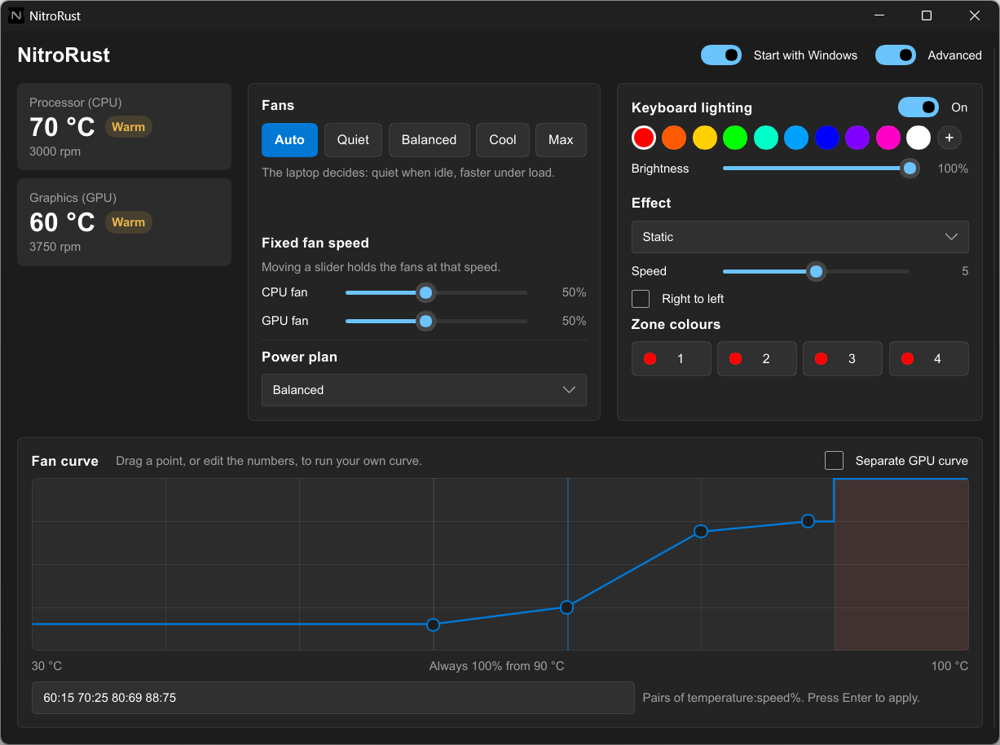
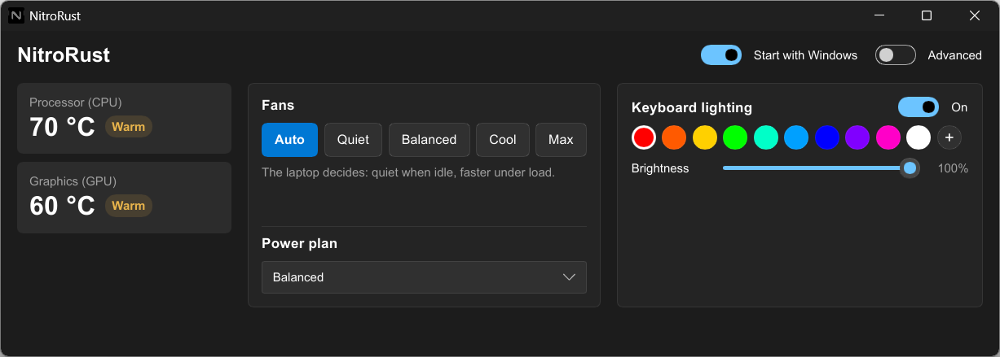
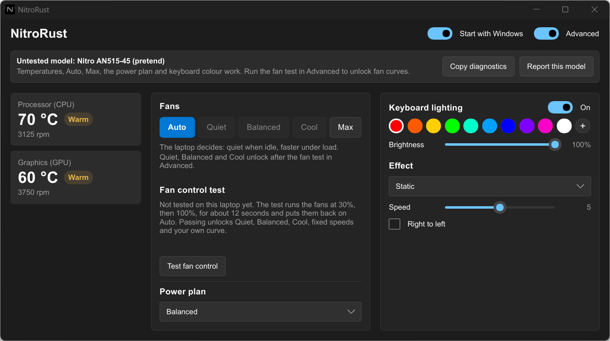

# NitroRust

A small, fast replacement for Acer NitroSense on **Acer Nitro laptops**, written in Rust.

It controls the fans (modes and your own fan curves), the Windows power plan and the keyboard lighting,
and shows CPU and GPU temperatures. It sits in the tray and uses almost no memory or CPU.
At startup it asks the laptop what it supports and only shows those controls
(see [Supported models](#supported-models)).



<details>
<summary>Simple view (Advanced off)</summary>



</details>

## Features

- **Five fan modes:** Auto (the laptop decides), Quiet, Balanced, Cool and Max.
  Quiet, Balanced and Cool are fan curves that NitroRust runs itself.
- **Your own fan curve:** drag the points on the graph or type `temperature:speed` pairs,
  for example `60:15 70:25 80:69 88:75`. One curve for both fans, or a separate GPU curve.
- **Safety:** from 90 °C the fans always run at 100 %, whatever the curve says.
- **Temperatures** shown as Cool (under 60 °C), Warm (60–80 °C) or Hot (over 80 °C), with fan RPM in Advanced.
- **Keyboard lighting:** on/off, any colour, brightness. Advanced adds effects (wave, breathing and others),
  speed, direction and a colour for each of the 4 zones.
- **Power plan** picker (the Windows power plans).
- **Tray icon** with Open, the 5 fan modes and Exit. Hover it to see live temperatures and fan speeds. Closing the window keeps NitroRust in the tray, and the readings keep updating every 2 seconds.
- **Start with Windows:** starts hidden in the tray at sign-in, with no UAC prompt, and re-applies your settings.
- Follows the Windows light/dark theme and accent colour. Resizable window.

## NitroRust vs. Acer NitroSense

Measured on the same laptop (Nitro AN515-45, Ryzen 7 5800H, RTX 3060 Laptop, Windows 11),
each app idle for 30 seconds. CPU is the share of all 16 CPU threads.

| | Acer NitroSense 3.1 | NitroRust |
|---|---|---|
| **RAM, window open** | 144–147 MB, plus 24 MB for the Predator Service it needs (about 170 MB) | **28–29 MB** |
| **RAM, minimised / in the tray** | 140 MB + 24 MB | **5.5 MB** (still reading the sensors every 2 s) |
| **CPU, window open** | 11.3–12.7 % (about 2 threads busy) | **0.0–0.04 %** |
| **CPU, minimised / in the tray** | 2.6 % + 0.16 % | **0.14 %** |
| **GPU** | No GPU activity recorded | No GPU activity recorded (NitroRust draws with the CPU) |
| **Disk** | 18.8 MB app + 14.5 MB service | **8.7 MB**, one exe |
| **Background service** | Yes (Predator Service) | No |
| **Fan control** | Auto, Max, fixed speed | Auto, Max, fixed speed, 3 curve presets, your own curve |
| **Fan curve editor** | No | Yes, with a 90 °C safety rule |
| **Keyboard lighting** | Yes | Yes |
| **Resizable window** | No | Yes |

How it was measured: Windows process counters (working set, CPU time over 30 s,
`\GPU Engine(*)\Utilization Percentage`), both windows on screen and nothing clicked.
The numbers are from one laptop; yours will differ a little.

## Install

**Needs:** an Acer Nitro laptop (see [Supported models](#supported-models)) and 64-bit Windows 10 or 11.

1. Download `NitroRust-Setup-<version>.exe` from the [latest release](https://github.com/deadnme/NitroRust/releases/latest).
2. Run it. Windows SmartScreen may warn because the installer is not signed:
   click **More info**, then **Run anyway**.
3. Pick the options (Start with Windows is on by default) and click **Install**.
4. NitroRust opens. Windows asks for administrator permission each time you open it by hand,
   because Acer's fan and lighting controls only answer an administrator. Start with Windows skips this prompt.

**Turn off Acer NitroSense first.** Two apps controlling the same fans fight each other.
Close NitroSense and stop it starting with Windows (Task Manager > Startup apps),
or uninstall it from Settings > Apps.

**Uninstall:** Settings > Apps > Installed apps > NitroRust > Uninstall.
This closes NitroRust (fans go back to Auto) and removes the Start with Windows task.
Your settings stay in `%APPDATA%\NitroRust` in case you reinstall; delete that folder to remove them.

### Without the installer

Download `nitrorust.exe` from the release, put it in any folder and run it.
Use the **Start with Windows** switch in the app if you want it at sign-in.

## Using it

- **Fans:** pick a mode. Quiet, Balanced, Cool and your own curve are run by NitroRust,
  so keep it running (the tray is fine). Auto and Max are handled by the laptop itself.
- **Advanced** (top right) shows fixed fan speeds, the curve editor, fan RPM, keyboard effects and zone colours.
  Your choice is remembered.
- Every change applies straight away. There is no Apply button.
- When you exit from the tray, the fans go back to Auto.
- Settings are saved in `%APPDATA%\NitroRust\settings.txt`.

Command line:

```
nitrorust.exe                    open the window (or show the copy that is already running)
nitrorust.exe --tray             start hidden in the tray
nitrorust.exe --autostart on|off turn Start with Windows on or off
nitrorust.exe --exit             close the running copy (fans go back to Auto)
```

To try safe mode on a verified laptop, start it with the environment variable
`NITRORUST_PRETEND_UNVERIFIED=1`.

## Supported models

NitroRust talks to Acer's `AcerGamingFunction` WMI interface, the same one NitroSense and PredatorSense use.
At startup it asks the laptop, without changing anything, which sensors, fans and lighting it has,
and hides what isn't there.

| Model | Status |
|---|---|
| Nitro AN515-45 | ✅ Verified: everything works |
| Other Nitro (and Predator) laptops | 🧪 Safe mode, see below |

**Safe mode** (any model not on the verified list):

- Temperatures, **Auto**, **Max**, the power plan and keyboard on/off, colour, brightness and effects work straight away.
- **Quiet, Balanced, Cool, fixed speeds and your own curve** unlock after the **fan test** (Advanced > Test fan control).
  It runs the fans at 30 % and then 100 % for about 12 seconds, checks the fan speed follows,
  and puts them back on Auto. If the laptop ever refuses a fan setting, NitroRust puts the fans back on Auto
  and locks these modes again.
- **Per-zone keyboard colours** stay hidden: the zone colour format differs between models.
  One colour for the whole keyboard still works.



### Add your model

1. Open NitroRust and click **Report this model** in the banner
   (or **Report a problem** in Advanced on a verified model).
2. Your browser opens a GitHub issue with your model and a diagnostics report already filled in.
   The report has no personal details: no user name, serial number or file paths.
3. Tick what works and submit. Models with good reports get added to the verified list.

**Copy diagnostics** copies the same report if you'd rather paste it yourself.

## Known limits

- Only the Nitro AN515-45 is verified so far. Firmware power profiles (Quiet/Balanced/Performance/Turbo
  on newer models) aren't supported yet; the power plan picker uses Windows power plans.
- Fixed fan speed (Advanced sliders) has no 90 °C safety rule. Use a curve if you want one.
- If Windows Explorer restarts, the tray icon does not come back until you open NitroRust again.
- If the laptop's fan controls stop responding, the window can freeze until they answer.
- If a temperature sensor read fails, the tile can show 0 °C for a moment.

## Build from source

Needs [Rust](https://rustup.rs) (stable, MSVC toolchain) and the Visual Studio C++ Build Tools.

```
cd rs
cargo build --release
cargo test --release
```

The exe is `rs\target\release\nitrorust.exe`. Run it as administrator.

`rs\cargo.cmd` is a helper for a machine where the Build Tools are not on the PATH:
it loads the VS 2019 Build Tools environment and then runs cargo. Edit the path in it for your setup.

To build the installer, install [Inno Setup 6.3 or later](https://jrsoftware.org/isinfo.php), then run this from the repo root:

```
ISCC.exe installer\NitroRust.iss
```

The installer is written to `installer\Output\`.

### Project layout

```
rs/src/main.rs       app logic, tray, single instance, fan curve thread
rs/src/acer.rs       AcerGamingFunction WMI calls and the read-only startup probe
rs/src/caps.rs       what the laptop supports, verified models, diagnostics report
rs/src/proto.rs      WMI payloads for fans, temperatures and keyboard
rs/src/curve.rs      fan curves and presets
rs/src/power.rs      Windows power plans
rs/src/settings.rs   saved settings and the Start with Windows task
rs/ui/app.slint      the UI (Slint, Fluent style)
installer/           Inno Setup script
extras/Launcher.cs   resizable window launcher for Acer's own NitroSense (see below)
```

## Extra: resizable Acer NitroSense

Before NitroRust, this project started as a launcher that makes Acer's own NitroSense window resizable
and square-cornered. The source is `extras/Launcher.cs`. Acer's files are not included.

To use it, copy the files of your NitroSense install into a folder (here `C:\NitroSenseCopy`),
build the launcher into that folder from the repo root, then run `C:\NitroSenseCopy\NitroSenseResizable.exe [width]`:

```
set F=C:\Windows\Microsoft.NET\Framework64\v4.0.30319
%F%\csc.exe -nologo -target:winexe -out:C:\NitroSenseCopy\NitroSenseResizable.exe -r:%F%\WPF\PresentationFramework.dll -r:%F%\WPF\PresentationCore.dll -r:%F%\WPF\WindowsBase.dll -r:%F%\System.Xaml.dll extras\Launcher.cs
```

## Disclaimer

NitroRust is not made by or affiliated with Acer. NitroSense, Nitro and Predator are Acer trademarks.
It changes fan speeds on real hardware: use it at your own risk.

## License

[MIT](LICENSE)
